# Mini-simulador de memoria compartida distribuida (DSM)

Proyecto 10 de Sistemas Operativos. **Dos procesos independientes intercambian páginas
por TCP y coordinan sus lecturas y escrituras.** Este README reúne la explicación,
los diagramas, los contratos técnicos, las instrucciones de uso, las pruebas y la entrega.

Equipo: Armando, Daniel, Guillermo, Daniel y Mauricio. Docente: David Garcia Cerna.
Faltan apellidos, institución y sección para personalizar los documentos finales.

Implementación: C11, Linux/Pop!_OS, TCP IPv4 en `127.0.0.1`, un hilo por proceso,
256 páginas de 4096 bytes por nodo. El fallo de página es **simulado** mediante un
chequeo de estado; no se interceptan accesos arbitrarios de C ni fallos del kernel.

Los diagramas están escritos en **Mermaid dentro de este mismo archivo**: GitHub y los
visores Markdown compatibles los representan gráficamente. Si tu vista previa muestra
el código del diagrama, abre el README en GitHub o en un visor con soporte Mermaid.
No se necesita Mermaid para compilar o ejecutar el simulador.

## Índice

1. [Empezar en Pop!_OS](#inicio)
2. [La idea en palabras sencillas](#guia)
3. [Teoría: DSM, paginación, coherencia y consistencia](#teoria)
4. [Memoria y metadatos](#memoria)
5. [Arquitectura y recorrido por el código](#arquitectura)
6. [Arranque y conexión](#arranque)
7. [Leer: migración y copia de lectura](#lectura)
8. [Escribir: exclusividad e invalidación](#escritura)
9. [Estados de una página](#estados)
10. [Transacciones, orden y BUSY](#transacciones)
11. [Transporte TCP y protocolo](#tcp)
12. [Demo paso a paso y guion del video](#demo)
13. [Comandos, logs y solución de problemas](#comandos)
14. [Pruebas y evidencia](#pruebas)
15. [Auditoría, límites y mejoras pendientes](#auditoria)
16. [Entregables y requisitos de la asignatura](#entrega)
17. [Fuentes y documentación histórica](#fuentes)

<a id="inicio"></a>
## 1. Empezar en Pop!_OS

Desde la raíz del repositorio:

```sh
make
```

En la terminal 1:

```sh
./build/dsm-node --id 0 --port 5000 --peer-port 5001
```

En la terminal 2, desde la misma carpeta:

```sh
./build/dsm-node --id 1 --port 5001 --peer-port 5000
```

Espera **`DSM_READY` en ambos nodos**. Ejecuta una línea a la vez y espera su resultado.
Ambos escuchan, N0 conecta y N1 acepta. El orden de arranque puede invertirse.
Enter o `exit` solicitan cierre; Ctrl+C permite terminar también durante el arranque.

Requisitos de ejecución: GCC/Clang compatible con C11 y Make. Python 3 se utiliza para
pruebas, demo automática y empaquetado; LaTeX, IEEEtran y Beamer para generar PDFs.
Esas herramientas ya estaban disponibles en el equipo verificado con Pop!_OS 24.04.
El programa C no utiliza bibliotecas externas, Docker, MPI ni máquinas virtuales.

Solo si faltan herramientas en otra instalación:

```sh
sudo apt update
sudo apt install build-essential python3
# Opcional: regenerar artículo y presentación desde LaTeX.
sudo apt install texlive-latex-extra texlive-publishers texlive-lang-spanish
```

Son instrucciones para otra instalación; no se ejecutaron para redactar esta documentación.
Los PDFs se pueden leer sin instalar LaTeX. Consulta la incidencia de Git de la demo
automática en [auditoría](#auditoria) si trabajas desde un ZIP extraído.

<a id="guia"></a>
## 2. La idea en palabras sencillas

Piensa en dos personas con cuadernos separados de 256 hojas. No pueden ver el cuaderno
del otro: deben pedirse hojas por un canal. En esta simulación, cada hoja es una página
y el canal es una conexión TCP.

Al inicio N0 tiene todas las páginas válidas, vacías y bajo su propiedad. N1 tiene
espacio reservado, pero sus páginas son INVALID: sus bytes no se pueden utilizar.
Cuando N1 necesita una página, la solicita, recibe sus bytes y continúa la operación.

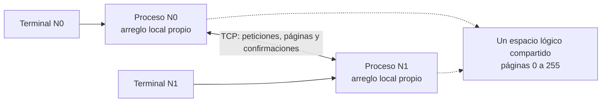

Las flechas punteadas representan la **abstracción lógica**. No hay un arreglo físico
compartido entre los procesos. Las flechas TCP sí representan comunicación real.

N0 mantiene un directorio: una lista de quién es dueño y quién tiene una copia válida.
Siempre coordina las operaciones, aunque la página pertenezca a N1. **Coordinador y
propietario son roles diferentes.**

<a id="teoria"></a>
## 3. Teoría: DSM, paginación, coherencia y consistencia

| Concepto | Significado | Cómo aparece en este proyecto |
|---|---|---|
| DSM | Memoria lógica compartida sobre memorias separadas. | Dos arreglos propios se coordinan con mensajes. |
| Página | Unidad lógica de datos y transferencia. | Bloque de 4096 bytes. |
| Fallo de página | Un acceso necesita datos que no están disponibles localmente. | El programa detecta INVALID y registra PAGE_FAULT. |
| Propiedad | Identifica la copia autoritativa. | OWNER y directorio de N0. |
| Exclusividad | Solo el solicitante conserva permiso para modificar. | Invalidaciones antes de GRANT_WRITE. |
| Coherencia | Las copias válidas de una página concuerdan en reposo. | Se descartan lógicamente copias antes de cambiar datos. |
| Consistencia | Define qué orden y valores de los accesos se permiten observar. | N0 ordena una operación admitida a la vez. |

En un sistema de memoria virtual transparente, el mecanismo de acceso y manejo de
fallos puede recuperar páginas automáticamente. Aquí el usuario usa `read` y `write`:
una función revisa metadatos y simula el fallo. No se usan SIGSEGV, mmap, mprotect ni
cambios de kernel para interceptar instrucciones.

**La coherencia se refiere a las copias; la consistencia, al orden de los accesos.**
Este ejemplo muestra un orden válido de operaciones admitidas:

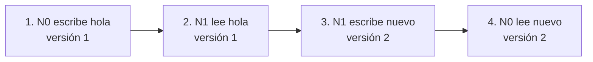

Las lecturas deben observar los datos del último write de ese orden. La consistencia
secuencial exige poder explicar los resultados mediante un orden compatible con el
orden de cada participante. Serializar en N0 facilita ese razonamiento para esta API
explícita y una sesión sin fallos. Las pruebas aportan evidencia experimental; no son
una demostración formal de todos los intercalados posibles.

### Migrar y replicar son operaciones diferentes

- **`read` migra:** deja un único dueño y los demás nodos inválidos para esa página.
- **`read-copy` replica:** conserva al dueño y permite una copia READ_ONLY en el otro nodo.
- **`write` exige exclusividad:** invalida las demás copias antes de modificar.

La guía del docente exige migración para la lectura remota. El diseño inicial proponía
replicar todas las lecturas; se separaron las dos órdenes para cumplir esa migración
y demostrar también el escenario de invalidación de lectores.

<a id="memoria"></a>
## 4. Memoria y metadatos

Cada proceso reserva `256 × 4096 = 1 048 576 bytes`, es decir, **1 MiB** contiguo.
Ambos tienen bytes reservados para todas las páginas; sus etiquetas deciden cuáles
pueden utilizar. Tener memoria asignada no equivale a tener una copia válida.

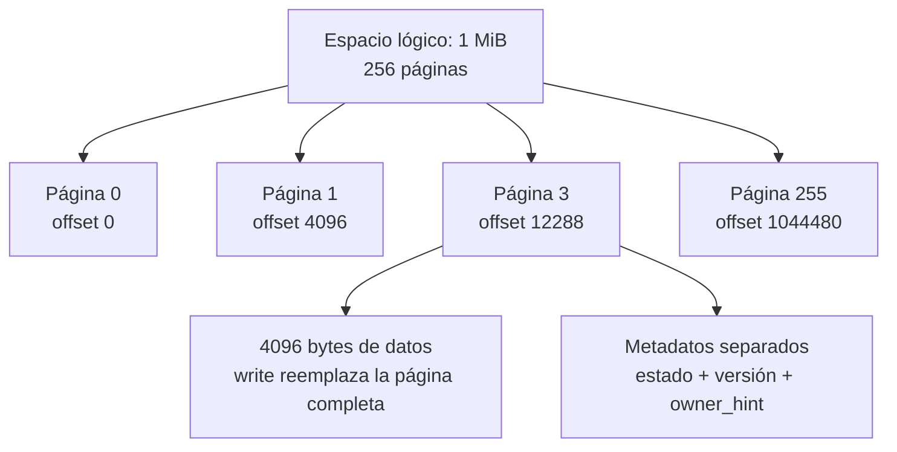

Se muestran cuatro páginas como ejemplo; existen todas las páginas 0–255.
La dirección de una página es `memory.bytes + p * DSM_PAGE_BYTES`; se valida `p`
antes de acceder. El tamaño de 4096 bytes es una decisión del simulador, no una
medición de la página física del equipo.

| Estado | Qué permite |
|---|---|
| OWNER | Tiene la copia autoritativa. Aun así solicita autorización para escribir. |
| READ_ONLY | Tiene una copia válida para lectura; debe obtener exclusividad para escribir. |
| INVALID | No puede leer sus bytes residuales como datos vigentes. |

Inicio: N0 OWNER en todas, N1 INVALID en todas, datos cero y versión 0.
Cada escritura aumenta la versión una vez; leer, copiar e invalidar no la incrementan.
Se rechaza escribir si la versión ya es `UINT32_MAX`.

### Directorio e instantánea

| Campo de directorio | Ejemplo | Interpretación |
|---|---|---|
| owner | `1` | El dueño confirmado es N1. |
| version | `2` | La última escritura confirmada dejó versión 2. |
| valid_mask | `2` | Solo N1 tiene copia válida. |

La máscara usa bit 0 para N0 y bit 1 para N1: `1` = N0, `2` = N1, `3` = ambos.
El directorio solo decide en N0. En el contexto de N1 se reserva la misma estructura
para simplificar el código, pero no se utiliza como autoridad.

`owner_hint` es información local orientativa y puede estar desactualizada. No concede
permisos. Antes de invalidar a un dueño cuando faltan los datos al solicitante, N0
preserva una **instantánea** de la página en la transacción. Esa instantánea no se
registra como una copia de lectura del coordinador.

<a id="arquitectura"></a>
## 5. Arquitectura y recorrido por el código

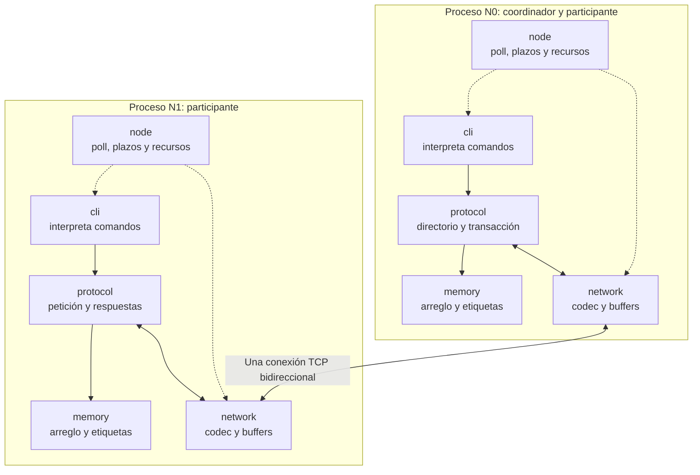

Las flechas representan coordinación entre módulos; la única comunicación entre
procesos es la conexión entre sus módulos network.

| Archivo/módulo | Responsabilidad |
|---|---|
| [src/main.c](src/main.c) | Valida ID y puertos; muestra ayuda; invoca el nodo. |
| [node](src/node/node.c) | Configura recursos/señales, conecta, negocia, atiende eventos y cierra. |
| [network](src/network/network.c) | Sockets, framing, acumulación parcial y cola de salida. |
| [memory](src/memory/memory.c) | Reserva, lee, instala, invalida y escribe páginas locales. |
| [protocol](src/protocol/protocol.c) | Decide permisos, secuencia transacciones y mantiene directorio. |
| [cli](src/cli/cli.c) | Analiza órdenes y presenta datos acotados y escapados. |
| [include/dsm](include/dsm) | Tipos y contratos compilables. |

Memory no conoce sockets. La CLI no escribe directamente el arreglo. Node enlaza los
módulos mediante contexto y un callback de envío, con un único hilo por proceso.

### Tipos y funciones principales

| Tipo | Propósito |
|---|---|
| DSMNode | ID, puertos, server_fd y peer_fd. |
| DSMMemory / DSMPage | Bytes contiguos y metadatos por página. |
| DSMDirectoryEntry | Propietario, versión y máscara confirmados. |
| DSMTransaction | Fase, origin/request, página, modo, ACK pendientes, plazo e instantánea. |
| DSMProtocol | Memoria, directorio, transacción, petición local y contadores. |
| DSMMessage | Representación lógica de cabecera y payload; no es el formato de red. |
| DSMReceiveBuffer / DSMSendBuffer | Bytes acumulados/pendientes y offsets. |
| DSMCommand | Orden, página y texto analizados. |

- `dsm_node_run` organiza el ciclo de vida y libera los recursos.
- `dsm_network_create_server`, `accept_peer` y `connect_peer` crean la comunicación.
- `dsm_network_queue`, `flush` y `receive_message` transportan las tramas binarias.
- `dsm_memory_init`, `read`, `install`, `invalidate`, `write` y `destroy` aplican operaciones locales.
- `dsm_protocol_start`, `on_message` y `command` negocian y despachan el protocolo.
- `dsm_protocol_status`, `busy` y `expired` exponen estado y controlan espera/plazos.
- `dsm_cli_parse`, `print_help` y `print_data` interpretan y presentan la interacción.

En las listas anteriores se abrevia el prefijo común de las funciones de cada módulo.
`memory_write` comprueba OWNER, límites y versión; corresponde a protocol garantizar
además que exista una concesión exclusiva vigente antes de llamarla.

<a id="arranque"></a>
## 6. Arranque y conexión

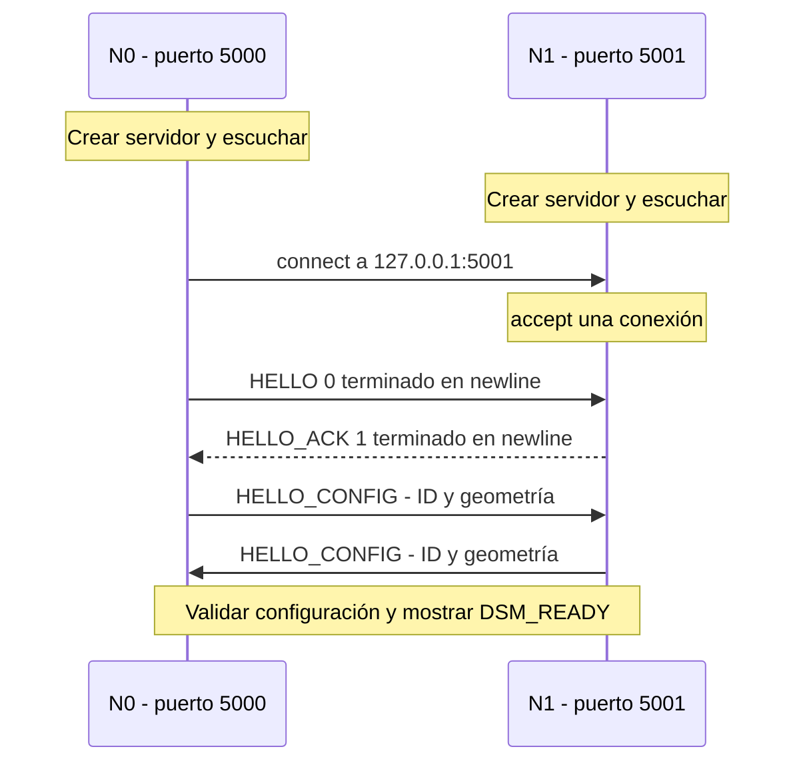

Ambos servidores se crean con `SO_REUSEADDR` y bind a loopback. Solo N0 conecta, con
hasta 30 intentos separados por 1 s ante `ECONNREFUSED`. N1 acepta una vez y espera
hasta conectar o recibir señal. El puerto origen del cliente es efímero: el socket
servidor 5000 de N0 no transporta el saludo. Los servidores permanecen abiertos hasta
el cierre, pero no se aceptan conexiones adicionales.

`--id` solo admite 0/1. Los puertos deben estar entre 1 y 65535, ser distintos y
corresponderse entre nodos. Se rechazan argumentos desconocidos, repetidos, ausentes
y números inválidos. `--help` explica el arranque.

<a id="lectura"></a>
## 7. Leer: migración y copia de lectura

### 7.1. read migra N0 → N1

Preparación: N0 ejecutó `write 3 hola`. N0 tiene OWNER, versión 1; N1 está INVALID.

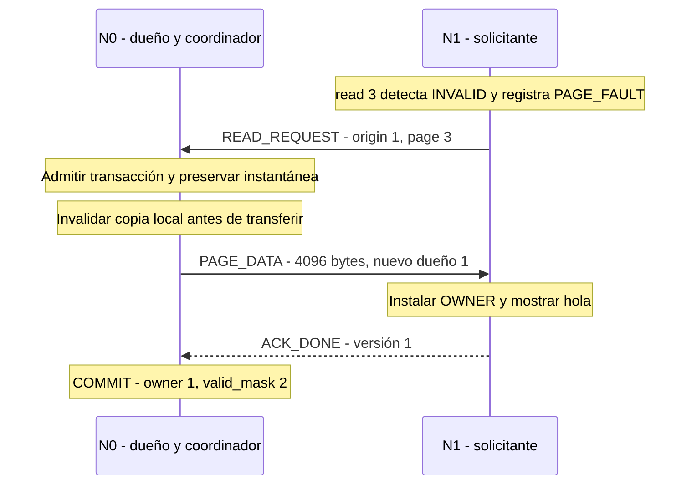

Al terminar en reposo: N0 INVALID, N1 OWNER. Los bytes antiguos de N0 pueden seguir
en el arreglo, pero su estado impide usarlos. Una lectura posterior desde N0 recupera
los datos de N1 con FETCH_PAGE y luego migra la propiedad en sentido inverso.

### 7.2. read-copy conserva al dueño

Ahora N1 es dueño y N0 está INVALID. N0 ejecuta `read-copy 3`:

```mermaid
sequenceDiagram
    participant N0 as N0 - solicitante y coordinador
    participant N1 as N1 - dueño
    Note over N0: Falta copia válida; petición local al coordinador
    N0->>N1: FETCH_PAGE - recuperar bytes actuales
    N1-->>N0: PAGE_DATA - FETCH_REPLY de 4096 bytes
    Note over N1: Conserva OWNER y la misma versión
    Note over N0: Conceder lectura local e instalar READ_ONLY
    Note over N0: Leer y confirmar localmente; COMMIT valid_mask 3
```

La concesión y confirmación de N0 son llamadas locales, no mensajes TCP a sí mismo.
Si el solicitante ya tiene una copia vigente, se usa GRANT y no se transfieren otra
vez los 4096 bytes. Todos los hits siguen pasando por la autorización del coordinador.

<a id="escritura"></a>
## 8. Escribir: exclusividad e invalidación

Ser OWNER no basta si el otro nodo conserva una copia de lectura. Antes de cambiar
los datos se deben invalidar los otros holders. Si faltan bytes al nuevo escritor,
se recuperan **antes** de invalidar al dueño anterior.

### 8.1. N1 escribe con una copia READ_ONLY en N0

Es la continuación de la demo anterior. N1 ejecuta `write 3 nuevo`:

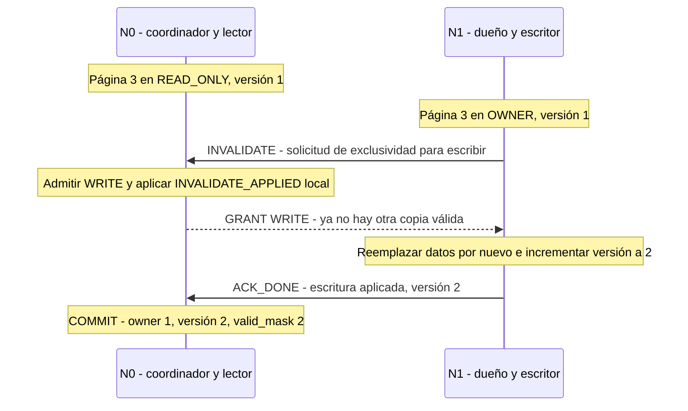

En esta dirección INVALIDATE inicia una petición de escritura del dueño. N0 confirma
la exclusividad con GRANT después de invalidarse; no envía un ACK de invalidación a
sí mismo. N1 no escribe simplemente por haber solicitado la invalidación.

### 8.2. N0 escribe con una copia READ_ONLY en N1

Esta dirección necesita una confirmación remota explícita:

```mermaid
sequenceDiagram
    participant N0 as N0 - coordinador y escritor
    participant N1 as N1 - lector
    Note over N0: write sobre página que también tiene N1
    N0->>N1: INVALIDATE - orden para descartar la copia
    Note over N0: Esperar; todavía no se permite escribir
    Note over N1: Aplicar estado INVALID
    N1-->>N0: ACK_INVALIDATED
    Note over N0: GRANT_WRITE local; escribir y aumentar versión
    Note over N0: ACK_DONE local y COMMIT
```

La prueba con ACK retrasado verifica que no aparezcan GRANT_WRITE ni escritura antes
de recibir esa confirmación. La diferencia de direcciones es importante: INVALIDATE
representa una **orden** N0 → N1 o una **solicitud de exclusividad** N1 → N0.

<a id="estados"></a>
## 9. Estados de una página

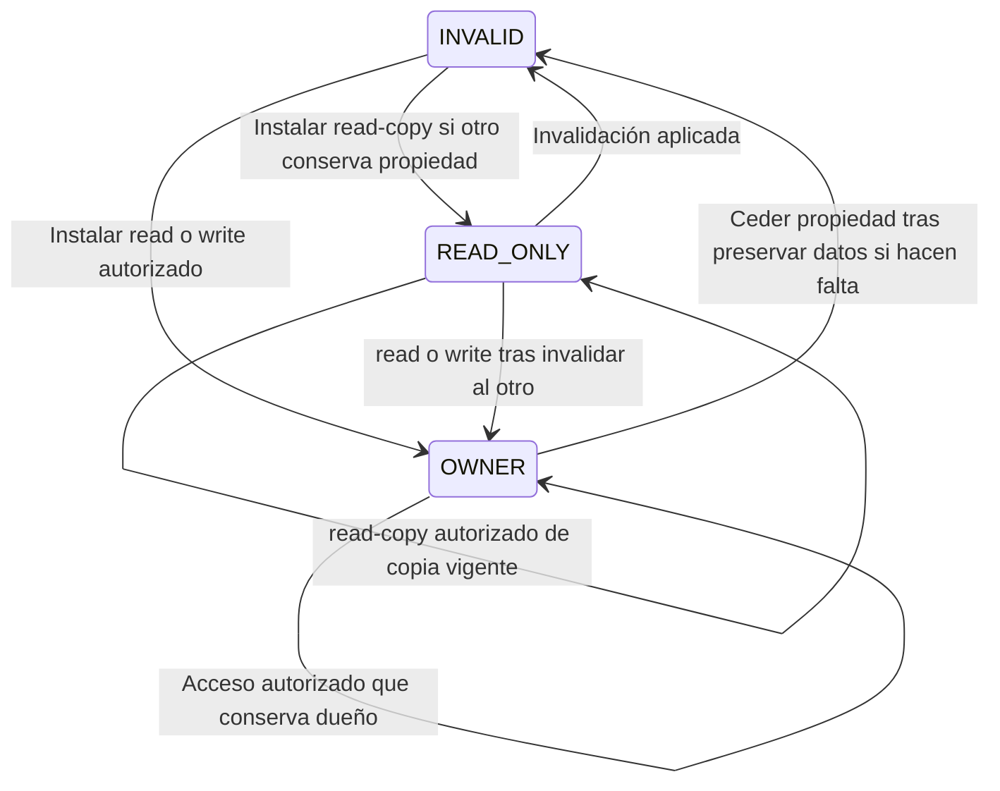

El diagrama es **local a una página en un nodo**. Para conocer el estado global hay
que considerar ambos nodos y el directorio.

Invariantes esperados en reposo:

1. Exactamente un OWNER por página, coincidente con el directorio.
2. Toda copia READ_ONLY contiene los mismos bytes y versión que el OWNER.
3. Una escritura requiere exclusividad y todas las invalidaciones necesarias aplicadas.
4. Una página INVALID no satisface una lectura.
5. El directorio confirma el cambio al completar ACK_DONE.

Durante una transferencia puede haber cero OWNER. La instantánea conserva los datos
y la transacción impide servir otra operación con ese estado intermedio. Un fallo
aborta la sesión; no se intenta recuperar automáticamente una propiedad incierta.

<a id="transacciones"></a>
## 10. Transacciones, orden y BUSY

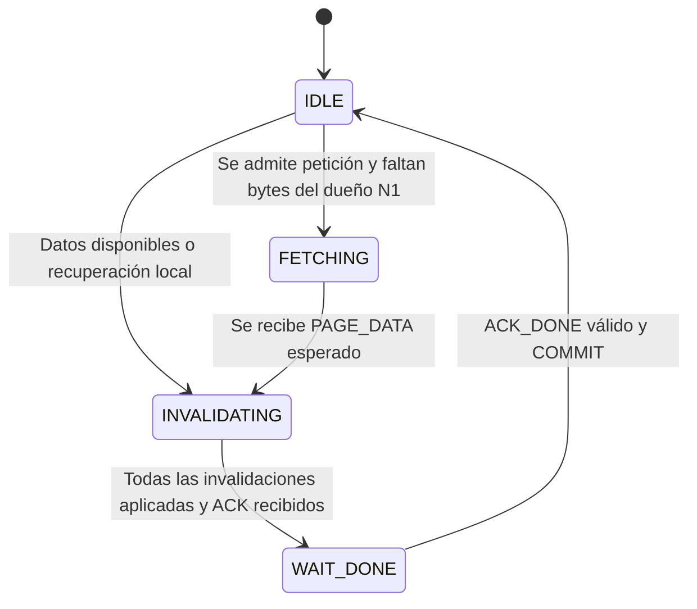

Son los cuatro estados reales de la transacción en N0. En INVALIDATING puede no
haber nadie que invalidar; se avanza directamente a la concesión en WAIT_DONE.

Mientras la transacción no está IDLE, una nueva operación recibe ERROR BUSY y no se
ejecuta. Esto también sucede si las dos operaciones usan páginas diferentes: la
serialización es global. El usuario reintenta manualmente con una nueva solicitud.
Cada nodo admite una petición local pendiente; `help` y `status` siguen disponibles.

Las respuestas se correlacionan con `(origin_id, request_id)`, página y fase. Cada
origen usa identificadores crecientes; ambos nodos pueden tener una petición número 1.
No se reutilizan IDs tras BUSY ni se permite desbordar el contador.

### El bucle de eventos

`poll()` atiende stdin y socket, con comprobación periódica de plazos. La entrada se
acumula hasta newline y la red procesa hasta 32 mensajes por lote. La recepción y
el vaciado de la cola usan `MSG_DONTWAIT`; EAGAIN conserva offsets para continuar.
Así una terminal inactiva o una trama incompleta no bloquean el servicio al peer.

<a id="tcp"></a>
## 11. Transporte TCP y protocolo

TCP entrega un flujo de bytes: una trama puede llegar en partes y dos tramas pueden
llegar juntas. La aplicación define sus fronteras y recuerda el progreso.

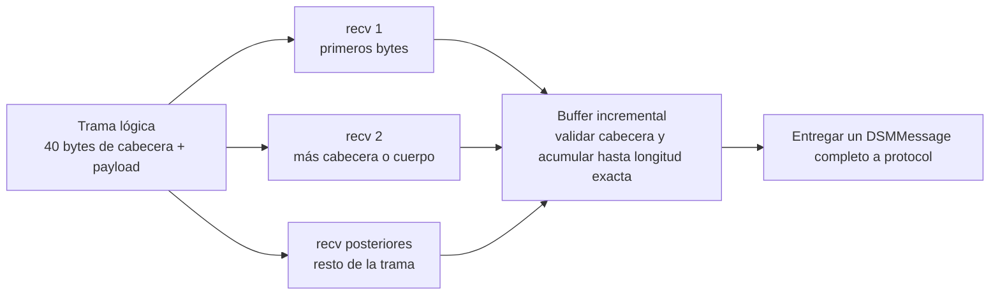

Las flechas muestran una posible fragmentación; la cantidad real de llamadas recv
la determina la ejecución. En el envío, una cola de **65536 bytes** conserva el
offset de lo transmitido. La cola no es una página DSM ni una copia válida del directorio.

### Cabecera binaria

Después del saludo textual y antes de los comandos se intercambia HELLO_CONFIG.
Todas las tramas binarias llevan diez `uint32` en big endian, 40 bytes en total:

| Offset | Campo | Función |
|---|---|---|
| 0 | magic | `0x44534D31`, identifica DSM1. |
| 4 | protocol_version | Versión de formato: 1. |
| 8 | type | Tipo de mensaje. |
| 12 | origin_id | Solicitante original, no necesariamente emisor físico. |
| 16 | request_id | Identificador creciente por origen. |
| 20 | page_id | Página; UINT32_MAX para HELLO_CONFIG. |
| 24 | owner_id | Dueño o hint; UINT32_MAX si no aplica o la copia declarada es inválida. |
| 28 | page_version | Versión de la página. |
| 32 | flags | Modo, fase de ACK o código de error. |
| 36 | payload_len | Bytes que siguen a la cabecera. |

No se transmite `sizeof(struct)`, padding, enums ni punteros. El codec valida
magic/versión, tipos conocidos, IDs, rangos y longitud exacta antes de recibir el
cuerpo. Protocol añade validación de roles y correlación; las carencias encontradas
en la auditoría están expresadas en su [sección correspondiente](#auditoria).

| Valor | Mensaje | Payload | Uso |
|---|---|---|---|
| 1 | HELLO_CONFIG | 12 bytes | node_id, page_count=256 y page_bytes=4096, en orden de red. |
| 2 | READ_REQUEST | 0 | Solicitar read o read-copy. |
| 3 | WRITE_REQUEST | 0 | Solicitar escritura cuando N1 no es dueño local. |
| 4 | FETCH_PAGE | 0 | N0 recupera bytes del dueño N1. |
| 5 | PAGE_DATA | 4096 bytes | Recuperación FETCH o instalación autorizada. |
| 6 | GRANT | 0 | Conceder acceso cuando los datos locales son vigentes. |
| 7 | INVALIDATE | 0 | Orden de invalidación o petición de exclusividad, según dirección. |
| 8 | ACK | 0 | Confirmación de invalidación o finalización. |
| 9 | ERROR | 0 | Rechazo BUSY o versión agotada. |

Flags: ACCESS_READ=1, ACCESS_COPY=2, ACCESS_WRITE=3; PAGE_DATA con flags=0 significa
FETCH_REPLY. ACK_INVALIDATED=1, ACK_DONE=2; ERROR_BUSY=1, ERROR_VERSION=2.
Las solicitudes locales de N0 se despachan mediante llamadas; no viajan por TCP a N0.

### Plazos y salida

El saludo/configuración tiene plazo absoluto de **10 s**; petición, transacción,
trama parcial y cola pendiente, **5 s**. Los plazos no se renuevan con cada fragmento;
su precisión depende del poll de 100 ms y de la planificación de Linux.
Se manejan EINTR, EAGAIN, EOF y errores de sockets; MSG_NOSIGNAL suprime SIGPIPE.

Enter, exit y EOF de stdin solicitan terminar tras atender la operación pendiente.
SIGINT/SIGTERM solicitan aborto. La intención es finalizar normalmente ante EOF de
red en reposo y abortar durante una operación o trama incompleta. La auditoría detectó
una excepción de cierre parcial que aún requiere corrección, descrita más adelante.
Los datos son volátiles: al reiniciar ambos nodos, vuelve el estado inicial.

<a id="demo"></a>
## 12. Demo paso a paso y guion del video

Ejecuta estas órdenes con ambos nodos en DSM_READY. **Espera RESULT antes de la
siguiente operación** y consulta estados después de la confirmación del coordinador.

| Paso | Nodo | Comando | Resultado esperado en reposo |
|---|---|---|---|
| 0 | Ambos | `status 3` | N0 OWNER, N1 INVALID, versión 0. |
| 1 | N0 | `write 3 hola desde N0` | N0 OWNER, versión 1. |
| 2 | N1 | `read 3` | Recibe hola desde N0; N0 INVALID, N1 OWNER. |
| 3 | Ambos | `status 3` | Confirma migración y directorio owner=1. |
| 4 | N0 | `read-copy 3` | N0 READ_ONLY; N1 conserva OWNER, versión 1. |
| 5 | N1 | `write 3 actualizado por N1` | Invalida N0 antes de escribir; versión 2. |
| 6 | N0 | `status 3` | N0 INVALID; dueño confirmado N1. |
| 7 | N0 | `read 3` | Recibe texto actualizado y recupera propiedad. |
| 8 | Ambos | `status 3` | N0 OWNER, N1 INVALID, versión 2. |
| 9 | N0 | `read 256` | Error local, sin modificar memoria. |
| 10 | Cualquiera | `exit` | Solicita cierre; observar ambos procesos. |

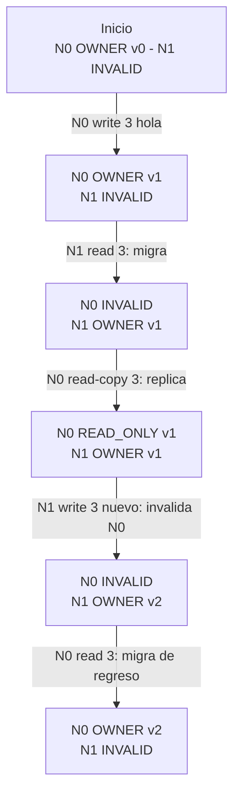

Se representa solo la página 3. Los textos del diagrama están abreviados; las cinco
operaciones de datos corresponden a los pasos 1, 2, 4, 5 y 7 de la tabla.

La demo automática desde un checkout Git se ejecuta con `make demo`. Verifica los
resultados y sobrescribe sus trazas/resumen en [docs/testing/evidence](docs/testing/evidence).
Actualmente falla al registrar el commit si se ejecuta desde un ZIP sin Git: consulta
[auditoría](#auditoria). La demo manual del binario no necesita metadatos Git.

### Guion sugerido para 8–10 minutos

1. Presentar problema y equipo; mostrar dos procesos con memorias propias (30–45 s).
2. Explicar directorio, estados y diferencia entre fallo real y simulado (1–2 min).
3. Mostrar la migración del paso 2 con PAGE_FAULT, PAGE_DATA y status (2 min).
4. Mostrar la copia de lectura y su invalidación antes de escribir (2 min).
5. Leer el texto actualizado desde N0 y explicar el ACK remoto en el caso inverso.
6. Demostrar un comando inválido y cierre; mostrar resultados de pruebas (~1 min).
7. Terminar con límites y mejoras pendientes (~1 min).

Usar dos terminales lado a lado, rótulos N0/N1 y letra grande. Revisar micrófono,
legibilidad y video completo antes de entregarlo. `make demo` guarda texto, no graba
un video. El equipo debe narrar y grabar la explicación con su herramienta de captura.

<a id="comandos"></a>
## 13. Comandos, logs y solución de problemas

| Orden | Efecto |
|---|---|
| `read <0..255>` | Lee y deja un dueño único; puede migrar propiedad. |
| `read-copy <0..255>` | Lee conservando al dueño; instala READ_ONLY si corresponde. |
| `write <0..255> <texto>` | Obtiene exclusividad y reemplaza toda la página. |
| `status [0..255]` | Estado/versiones, contadores y directorio confirmado en N0. |
| `help` | Ayuda. |
| `exit` o línea vacía | Solicita cierre ordenado. |

Texto de escritura: 1–4095 **bytes**, no necesariamente caracteres. Se eliminan
espacios iniciales antes del texto, se conservan los posteriores y no se interpretan
comillas ni shell. Se completa el resto de la página con ceros, incluido NUL.
El parser rechaza signos/rangos incorrectos, tokens sobrantes y desbordamientos.
Una línea demasiado larga o con NUL se descarta hasta newline y luego se recupera.
La salida de datos está acotada y escapa comillas, backslash y bytes no ASCII imprimibles.

`status` sin filtro muestra conteos y páginas con cambios respecto del inicio;
`status p` siempre muestra esa página. El directorio es el último estado confirmado,
que puede diferir de un estado local transitorio mientras la transacción está activa.

| Log | Cómo interpretarlo |
|---|---|
| DSM_READY | Identidad/geometría negociadas; CLI disponible. |
| PAGE_FAULT simulated=1 | Falta una copia válida; se solicita acceso. |
| LOCAL_HIT | Ya existen datos locales; sigue siendo necesaria autorización. |
| SEND / RECV | Mensaje encolado para envío / recibido completo. SEND no prueba recepción. |
| PAGE_INSTALLED | Se instalaron 4096 bytes con estado autorizado. |
| INVALIDATE_APPLIED | La copia ya pasó a INVALID. |
| GRANT_WRITE | Exclusividad concedida después de las invalidaciones. |
| RESULT | Resultado aplicado/obtenido localmente; no equivale a COMMIT remoto. |
| COMMIT | N0 confirmó la finalización y actualizó directorio. |
| OWNER_CHANGED | Cambió el dueño confirmado. |
| ERROR BUSY | Solicitud rechazada por otra transacción activa; reintentar. |

| Problema | Qué revisar |
|---|---|
| Reintentos sin conectar | Otro proceso iniciado, puertos cruzados y mismo localhost. |
| Address already in use | Cerrar procesos anteriores o elegir otros dos puertos. |
| No aparece DSM_READY | Configuración compatible, logs del peer y timeout de saludo. |
| BUSY | Esperar resultado/COMMIT y reintentar manualmente. |
| Bytes con escapes en el resultado | La consola escapa bytes no ASCII; el límite de texto se mide en bytes. |
| Timeout, desconexión o protocolo incorrecto | Reiniciar ambos nodos; no hay recuperación de sesión. |
| make demo falla con git rev-parse | Incidencia conocida del ZIP; ejecutar demo manual o desde checkout. |
| Diagramas visibles como código | El visor Markdown no tiene soporte Mermaid; abrir en GitHub o visor compatible. |

Preguntas para practicar: ¿por qué OWNER no basta para escribir?, ¿qué conserva la
instantánea?, ¿por qué TCP necesita framing?, ¿por qué N0 coordina aunque N1 sea dueño?,
¿qué diferencia read de read-copy?, ¿cuándo se confirma una invalidación?, ¿qué ocurre
si cae N0? Las respuestas están en las secciones anteriores.

<a id="pruebas"></a>
## 14. Pruebas y evidencia

```sh
make test-unit  # Tres programas C
make test       # Pruebas C y 22 casos de integración; aproximadamente 50 s
make sanitize   # ASan/UBSan y nueve casos DSM
make demo       # Demo verificada; requiere checkout Git por incidencia conocida
```

Cerrar la demo manual antes de `make test`: uno de los escenarios usa 5000/5001.
El resto utiliza puertos efímeros. Python es solo el harness: los procesos probados
son los ejecutables C. `DSM_BINARY` permite elegir otro ejecutable, y make sanitize
compila en build/sanitize sin sustituir el binario normal.

| Pruebas | Cobertura |
|---|---|
| [network_test.c](tests/unit/network_test.c) | Fragmentación, tramas juntas, EOF, SIGPIPE, envío íntegro, codec y cola EAGAIN. |
| [memory_cli_test.c](tests/unit/memory_cli_test.c) | Estados, permisos, versiones, límites y parser. |
| [protocol_test.c](tests/unit/protocol_test.c) | Esperar ACK, rechazar ACK falso, BUSY y expiración. |
| [test_sockets.py](tests/integration/test_sockets.py) | 13 escenarios de argumentos, arranque, TCP, cierre y timeout. |
| [test_dsm.py](tests/integration/test_dsm.py) | Nueve escenarios de migración, copias, exclusividad, datos y errores. |

Se prueban páginas 0 y 255, rechazo de 256, texto de 4095 bytes aceptado y de 4096
rechazado, EOF parcial, peer que muere, cabeceras malformadas y ACK retrasado. Un
oráculo compara 48 operaciones secuenciales con semilla fija 10. BUSY se provoca
con un peer controlado, no dependiendo de teclear al mismo tiempo.

### Resultados observados el 17 de octubre de 2026

Entorno: Pop!_OS 24.04 LTS, Linux 7.1.5, GCC 13.3, C11 con Wall/Wextra/Wpedantic.
Compilación limpia sin warnings; tres programas C y 22 casos de integración aprobados.
La ejecución histórica guardada tomó 48.166 s; la repetición de auditoría, 48.301 s.
Nueve casos DSM y las pruebas C pasaron con ASan/UBSan sin errores detectados en esas
ejecuciones. La duración incluye esperas deliberadas y no mide latencia DSM.

La auditoría ejecutó además 40 rondas con dos escritores reales: 62 escrituras y
18 BUSY, con dueño único y directorio concordante al terminar cada ronda. Esa
comprobación adicional aún no forma parte de los 22 casos de la suite permanente.

| Métrica al terminar la demo de cinco operaciones | N0 | N1 |
|---|---|---|
| Fallos simulados | 2 | 1 |
| Tramas PAGE_DATA enviadas | 1 | 2 |
| Tramas PAGE_DATA recibidas | 2 | 1 |
| Invalidaciones locales aplicadas | 2 | 1 |
| Commits del coordinador | 5 | No aplica |

Tres transferencias de 4096 bytes suman **12288 bytes de payload de páginas**,
además de control y cabeceras. La segunda escritura no retransmite la página que
N1 ya posee. Versión final de página 3: 2; dueño final: N0.

Evidencia original:

- [Salida de pruebas](docs/testing/evidence/test-results.txt).
- [Traza N0](docs/testing/evidence/demo-node0.txt) y [traza N1](docs/testing/evidence/demo-node1.txt).
- [Resumen de comandos y entorno](docs/testing/evidence/demo-summary.json).

El resumen registra commit base, árbol modificado y SHA-256 de fuentes, encabezados
y Makefile; un commit base no implica que contenga cambios aún no confirmados.
Los errores EPROTO de la prueba C son inyecciones deliberadas de ACK incorrectos;
evaluar PASS/OK y código de salida. Los resultados históricos no anulan los defectos
hallados posteriormente en la auditoría.

<a id="auditoria"></a>
## 15. Auditoría, límites y mejoras pendientes

La revisión identificó tres incidencias reproducibles que **no se corrigen mediante
este cambio de documentación**. No están cubiertas por los casos aprobados existentes:

| Prioridad | Incidencia | Impacto y corrección recomendada |
|---|---|---|
| Media | EOF de red con ACK todavía encolado. | Un cierre parcial después de conceder puede descartar el ACK y devolver éxito. Comprobar la cola y distinguir cierre normal de operación incompleta. |
| Media | PAGE_DATA con versión anterior. | Con coordinador de prueba N1 aceptó retroceder de versión 10 a 0. Validar versión antes de instalar y añadir regresión. |
| Media | make demo dentro del ZIP sin .git. | La consulta obligatoria de commit falla después de la demo. Hacer metadatos Git opcionales, manteniendo SHA-256, y probar el ZIP completo. |

El caso de versión antigua requiere un peer incoherente; no se observó entre dos
nodos correctos. La incidencia de cierre se reprodujo con half-close TCP. Son
hallazgos del tratamiento de errores y empaquetado que deben cerrarse antes de
considerar la entrega completamente revisada.

Límites de alcance: dos nodos, loopback, memoria volátil, páginas completas y una
operación global activa. Sin acceso transparente mediante punteros, swapping, LRU,
persistencia, autenticación, descubrimiento, reconexión ni recuperación de caídas.
N0 es un punto único de fallo. No se midió rendimiento de LAN ni se exploraron todos
los intercalados; las pruebas no equivalen a verificación formal.

Orden recomendado: corregir las tres incidencias y agregar sus regresiones; reforzar
pruebas de invariantes y concurrencia; después explorar medición de red o recuperación
con un protocolo diseñado para ello. Reconectar un socket no recupera por sí solo la propiedad.

<a id="entrega"></a>
## 16. Entregables y requisitos de la asignatura

La guía local `C06_ProyectoCatedraSO.pdf` define instrucciones en página 2, Proyecto 10
en página 12 y rúbrica en página 13. La documentación del docente no se publica con el ZIP.

| Requisito | Dónde se demuestra |
|---|---|
| Dos procesos por sockets en una máquina Linux | Arranque de N0/N1; integración con TCP real. |
| Arreglo lógico paginado y propietario inicial | DSMMemory, status inicial, N0 OWNER y N1 INVALID. |
| Detectar falta, pedir, invalidar, transferir e instalar | Diagrama de migración, PAGE_FAULT/PAGE_DATA y read. |
| Escritura exclusiva e invalidación de lectores | Diagramas de escritura, ACK y GRANT_WRITE. |
| Demo de migración y de invalidación | Secuencia de cinco operaciones y sus trazas. |
| Investigación y documentación | Este README, bibliografía y artículo IEEE. |
| Presentación ejecutiva | Fuente y PDF en presentation; generación con make docs. |
| Código y pruebas | src, include, tests, tools y Makefile. |
| Video explicativo | Guion en este README; el equipo debe grabarlo y revisarlo. |

### Generar documentos y paquete

```sh
make docs       # PDF del artículo y presentación; requiere LaTeX
make package    # ZIP de fuentes y PDFs
make help
```

Se mantienen en su lugar las fuentes del [artículo IEEE](docs/ieee/paper.tex) y de la
[presentación](presentation/presentacion.tex), junto a sus respectivos archivos.
`make docs` genera `build/entrega/paper.pdf` y `build/entrega/presentacion.pdf`.
La versión generada y revisada tiene 3 páginas de artículo y 12 diapositivas.

`make package` genera `build/entrega/proyecto10-dsm.zip`, con PDFs bajo
`proyecto10-dsm/entregables/`. El ZIP fue comprobado por integridad y compilación tras
extraerlo; la auditoría añadió la incidencia de demo sin Git. Regenerar documentos
no valida automáticamente cambios del código. **`make clean` elimina build**, incluidos
PDFs y ZIP generados; las fuentes permanecen y permiten regenerarlos.

Antes de entregar: completar apellidos, institución y sección; revisar artículo y
presentación; practicar la demo y responder preguntas; grabar y revisar el video;
confirmar y subir entregables a ECampus. La distribución de exposición debe reflejar
contribuciones reales, sin inventar autoría individual.

La guía indica 10 de noviembre a las 12:00 del mediodía y presentaciones el 12 y 19
de noviembre, 18:30–20:10, sin especificar año en esas líneas. Confirmar calendario
y grupo con el docente o en ECampus. No se ha grabado video ni realizado entrega externa.

<a id="fuentes"></a>
## 17. Fuentes y documentación histórica

Bibliografía primaria consultada el 17 de octubre de 2026:

1. K. Li y P. Hudak, *Memory Coherence in Shared Virtual Memory Systems*, ACM TOCS,
   7(4), pp. 321–359, noviembre 1989. [DOI](https://doi.org/10.1145/75104.75105),
   [texto original](https://people.eecs.berkeley.edu/~prabal/resources/osprelim/LH89.pdf).
   Antecedente de memoria compartida por páginas y gestores centrales/distribuidos.
2. L. Lamport, *How to Make a Multiprocessor Computer That Correctly Executes
   Multiprocess Programs*, IEEE Transactions on Computers, C-28(9), pp. 690–691,
   septiembre 1979. [Texto original](https://www.microsoft.com/en-us/research/wp-content/uploads/2016/12/How-to-Make-a-Multiprocessor-Computer-That-Correctly-Executes-Multiprocess-Programs.pdf).
   Referencia para la noción de consistencia secuencial.
3. Linux man-pages: [tcp(7)](https://man7.org/linux/man-pages/man7/tcp.7.html),
   [recv(2)](https://man7.org/linux/man-pages/man2/recv.2.html),
   [send(2)](https://man7.org/linux/man-pages/man2/send.2.html) y
   [poll(2)](https://man7.org/linux/man-pages/man2/poll.2.html).
   APIs y semántica del transporte usado por el código.
4. Guía de cátedra suministrada por el usuario: `C06_ProyectoCatedraSO.pdf`, páginas
   2, 12 y 13. Fuente de requisitos y evaluación, no publicación científica sobre DSM.

Este README es la referencia central para uso, teoría, arquitectura, protocolo, pruebas
y entrega. Los antiguos puntos de entrada de esos temas enlazan a sus secciones.
La planificación inicial y el [reporte de Fase 1](docs/planning/FASE1_SOCKETS.md) se
conservan como historial; sus propuestas no sustituyen el comportamiento vigente.
Las evidencias crudas permanecen en docs/testing/evidence. Las normas de contribución
siguen en [CONTRIBUTING.md](CONTRIBUTING.md). Artículo y presentación conservan sus fuentes.
