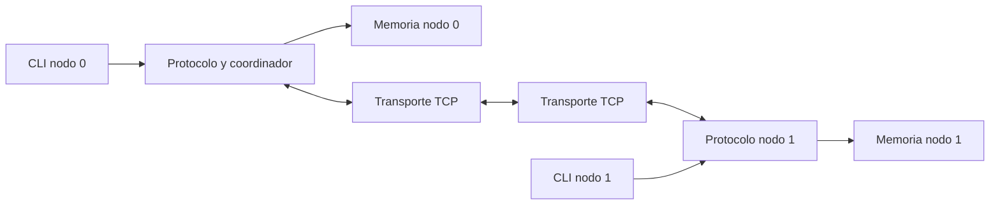

# Arquitectura propuesta

## Modelo

Dos ejecutables del mismo programa con `--id 0` o `--id 1`. N0 escucha; N1 conecta.
Una sola conexión TCP bidireccional sirve para control y páginas. Identidad, versión
del protocolo, número de páginas y tamaño de página se validan con HELLO antes de
aceptar comandos de memoria. No se necesitan cinco servicios ni un proceso coordinador
adicional: el rol coordinador reside en N0, aunque N1 sea dueño de los datos.

La lectura remota replica datos; la escritura migra la propiedad. No se afirma que
leer siempre cambie al propietario. El directorio autoritativo está exclusivamente
en N0; `owner_hint` de N1 solo sirve para mostrar información, nunca para conceder permisos.

## Módulos y contratos propuestos

| Módulo | Responsabilidad | Archivos futuros | Interfaz orientativa |
|---|---|---|---|
| node | Configuración, arranque, recursos, bucle de eventos y cierre | src/main.c, src/node/node.c, include/dsm/node.h | node_init, node_run, node_destroy |
| network | socket, conexión, tramas, buffers parciales y errores de transporte | src/network/network.c, include/dsm/network.h | network_listen, network_connect, network_receive, network_queue_send |
| memory | Arreglo local, metadatos, límites, instalación e invalidación | src/memory/memory.c, include/dsm/memory.h | memory_init, memory_install, memory_invalidate, memory_read, memory_write |
| protocol | Directorio, autorización, exclusividad, máquina de transacción | src/protocol/protocol.c, include/dsm/protocol.h | protocol_request_read, protocol_request_write, protocol_on_message |
| cli | Análisis de órdenes y presentación de resultados | src/cli/cli.c, include/dsm/cli.h | cli_parse, cli_print_status, cli_print_help |

`memory_write` recibe autorización de la transacción activa; comprobar solo OWNER
es insuficiente. Protocol controla la política, memory aplica operaciones locales
válidas y comprueba sus precondiciones. No exponer un puntero escribible a la CLI.
Un encabezado común `include/dsm/types.h` contendrá tipos compartidos, sin duplicarlos.

## Ejecución sin hilos

Recomendación: un bucle `poll()` para stdin y socket en cada proceso. Un comando en
espera no bloquea el despacho de FETCH_PAGE, INVALIDATE ni ACK. Un solo acceso global
activo; N0 devuelve ERROR(BUSY) a nuevos accesos y la CLI permite reintentarlos.
N0 también tramita su CLI mediante el mismo despachador, sin enviarse TCP a sí mismo.
Esto evita dos rutas con reglas de consistencia diferentes.

Al comenzar, probar intercambio secuencial bloqueante en un programa de prueba de
network; antes de integrar DSM, agregar recepción incremental y cola de envío con
socket no bloqueante. `poll()` seguido de un `recv_all` bloqueante podría congelar el
bucle ante una trama incompleta y no es el diseño final.

## Directorios

| Directorio | Contenido |
|---|---|
| src/ | Implementaciones C separadas por responsabilidad; main futuro conecta los módulos |
| include/dsm/ | Encabezados públicos internos al proyecto y tipos comunes |
| tests/unit/ | Pruebas de memoria, serialización, parser y transiciones sin dos procesos |
| tests/integration/ | Pruebas con ambos nodos y verificación de trazas/resultados |
| docs/architecture/ | Contratos de módulos, estados, protocolo, tipos y CLI |
| docs/research/ | Notas teóricas breves, fuentes y relación con decisiones del simulador |
| docs/testing/ | Plan, escenarios y evidencia de ejecución |
| docs/planning/ | Fases, responsabilidades, issues y orden inicial |
| docs/ieee/ | Esquema y posteriormente fuentes del artículo, sin resultados inventados |
| demo/ | Guion reproducible, órdenes y posteriormente registros seleccionados |
| presentation/ | Esquema de exposición y posteriormente diapositivas |

Los `.gitkeep` conservan carpetas vacías. No son módulos implementados. No agregar
bibliotecas de terceros por adelantado; Make, compilador C y utilidades Linux bastan.
