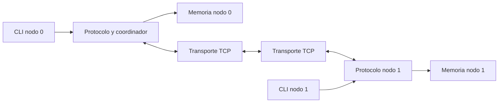

# Arquitectura: Fase 1 y diseño futuro

## Implementado en Fase 1

Ambos procesos crean un servidor TCP IPv4 en loopback. **N0 conecta a N1; N1 acepta**.
Esta decisión sustituye el arranque anteriormente propuesto (N0 escucha y N1 conecta).
N0 reintenta ECONNREFUSED hasta 30 intentos separados por 1 segundo; ambos órdenes de
arranque están soportados. Solo se acepta una conexión por sesión y no hay reconexión.
El socket servidor permanece abierto hasta el cierre; no se aceptan peers adicionales.

```text
N0: servidor 127.0.0.1:5000          N1: servidor 127.0.0.1:5001
    cliente ---------------------->    accept
            una conexión TCP bidireccional
            HELLO 0 -------------->
                    <-------------- HELLO_ACK 1
```

`DSMNode` guarda ID, puertos y los dos descriptores. `main` valida argumentos;
`node` coordina arranque, HELLO, entrada mínima y cierre; `network` gestiona sockets,
envío completo y recepción incremental de líneas de hasta 127 bytes (sin `\n`).
Se rechazan NUL, líneas demasiado largas, EOF parcial y mensajes HELLO inesperados.
`poll()` atiende la red y, después del HELLO, stdin; no hay hilos. La recepción usa
MSG_DONTWAIT y conserva líneas parciales; no bloquea el bucle esperando una línea.
El envío es bloqueante: suficiente para los mensajes HELLO pequeños de esta fase.
HELLO vence tras 10 segundos sin actividad de red; Ctrl+C/SIGTERM cierran recursos.
`memory`, `protocol` y `cli` permanecen como stubs, sin inicializarse desde `node`.
No hay memoria DSM ni validación de geometría de páginas o versión de protocolo.

Ver [reporte y pruebas](../planning/FASE1_SOCKETS.md).

## Modelo futuro (sin implementar)

Dos ejecutables del mismo programa con `--id 0` o `--id 1`. Ambos escuchan; N0 conecta a N1.
Una sola conexión TCP bidireccional sirve para control y páginas. Identidad, versión
del protocolo, número de páginas y tamaño de página se validan con HELLO antes de
aceptar comandos de memoria. No se necesitan cinco servicios ni un proceso coordinador
adicional: el rol coordinador reside en N0, aunque N1 sea dueño de los datos.



La lectura remota replica datos; la escritura migra la propiedad. No se afirma que
leer siempre cambie al propietario. El directorio autoritativo está exclusivamente
en N0; `owner_hint` de N1 solo sirve para mostrar información, nunca para conceder permisos.

## Módulos y contratos propuestos

| Módulo | Responsabilidad | Archivos futuros | Interfaz orientativa |
|---|---|---|---|
| node | Configuración, arranque, recursos, bucle de eventos y cierre | src/main.c, src/node/node.c, include/dsm/node.h | node_init, node_run, node_destroy |
| network | socket, conexión, tramas, buffers parciales y errores de transporte | src/network/network.c, include/dsm/network.h | network_listen, network_connect, network_receive, network_queue_send |
| memory | Arreglo local, metadatos, límites, instalación e invalidación | src/memory/memory.c, include/dsm/memory.h | memory_init, memory_install, memory_invalidate, memory_read, memory_write |
| protocol | Directorio, autorización, exclusividad, máquina de transacción | src/protocol/protocol.c, include/dsm/protocol.h | protocol_request_read, protocol_request_write, protocol_on_message |
| cli | Análisis de órdenes y presentación de resultados | src/cli/cli.c, include/dsm/cli.h | cli_parse, cli_print_status, cli_print_help |

`memory_write` recibe autorización de la transacción activa; comprobar solo OWNER
es insuficiente. Protocol controla la política, memory aplica operaciones locales
válidas y comprueba sus precondiciones. No exponer un puntero escribible a la CLI.
Un encabezado común `include/dsm/types.h` contendrá tipos compartidos, sin duplicarlos.

## Ejecución DSM futura sin hilos

Recomendación: un bucle `poll()` para stdin y socket en cada proceso. Un comando en
espera no bloquea el despacho de FETCH_PAGE, INVALIDATE ni ACK. Un solo acceso global
activo; N0 devuelve ERROR(BUSY) a nuevos accesos y la CLI permite reintentarlos.
N0 también tramita su CLI mediante el mismo despachador, sin enviarse TCP a sí mismo.
Esto evita dos rutas con reglas de consistencia diferentes.

La Fase 1 ya tiene recepción incremental de líneas. Antes de integrar DSM, adaptar
el framing al formato binario futuro y agregar una cola de envío con socket no bloqueante. `poll()` seguido de un `recv_all` bloqueante podría congelar el
bucle ante una trama incompleta y no es el diseño final.

## Directorios

| Directorio | Contenido |
|---|---|
| src/ | Implementaciones C separadas por responsabilidad; main futuro conecta los módulos |
| include/dsm/ | Encabezados públicos internos al proyecto y tipos comunes |
| tests/unit/ | Pruebas de memoria, serialización, parser y transiciones sin dos procesos |
| tests/integration/ | Pruebas con ambos nodos y verificación de trazas/resultados |
| docs/architecture/ | Contratos de módulos, estados, protocolo, tipos y CLI |
| docs/research/ | Notas teóricas breves, fuentes y relación con decisiones del simulador |
| docs/testing/ | Plan, escenarios y evidencia de ejecución |
| docs/planning/ | Fases, responsabilidades, issues y orden inicial |
| docs/ieee/ | Esquema y posteriormente fuentes del artículo, sin resultados inventados |
| demo/ | Guion reproducible, órdenes y posteriormente registros seleccionados |
| presentation/ | Esquema de exposición y posteriormente diapositivas |

Los `.gitkeep` conservan carpetas vacías. No son módulos implementados. No agregar
bibliotecas de terceros por adelantado; Make, compilador C y utilidades Linux bastan.
